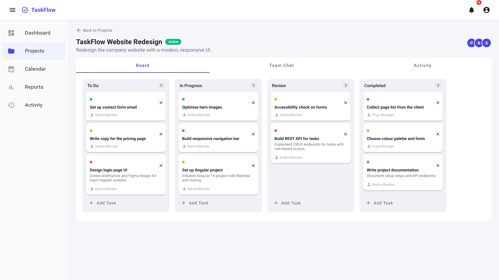
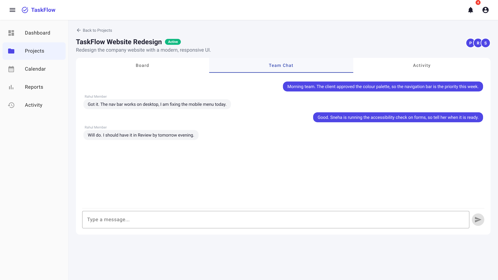
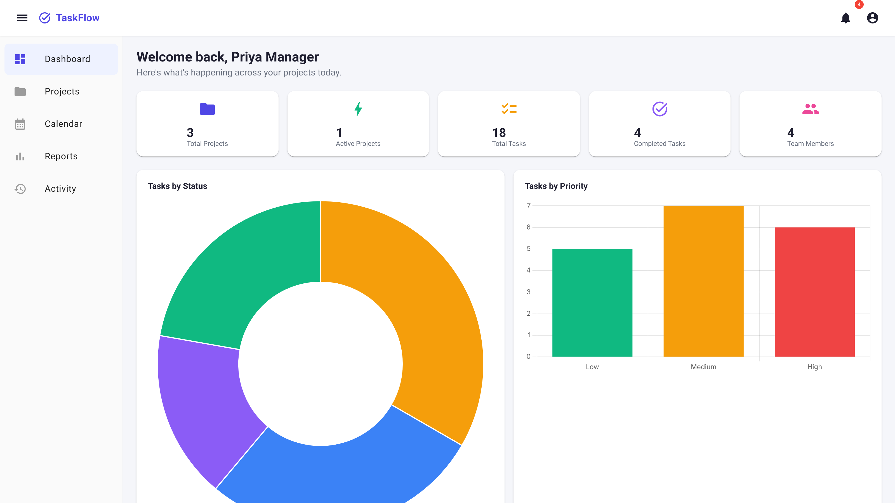
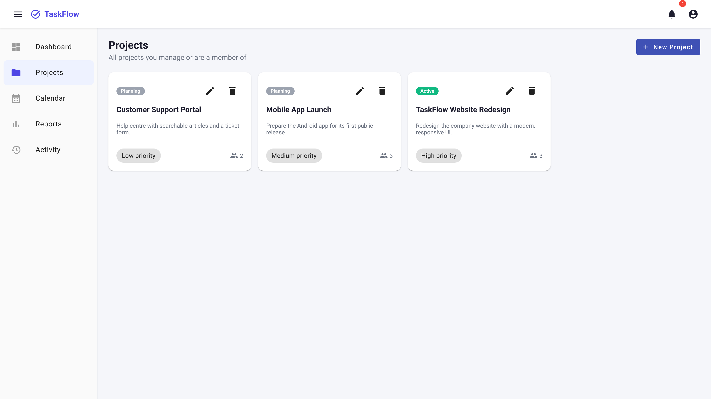

# TaskFlow

**Project and team management for small teams: a Kanban board, live team chat, and role-based access in one app.**

Built with Angular 19, Node.js/Express, MongoDB and Socket.IO.

## Screenshots

**Kanban board.** Tasks move between columns by drag-and-drop.



**Team chat.** Messages appear live for everyone in the project.



| Dashboard | Projects |
|---|---|
|  |  |

Screenshots show the app running locally with sample data.

## What it does

- **Kanban board** with drag-and-drop between columns. A team member can move their own assigned tasks; only an Admin or Project Manager can create or delete tasks.
- **Live team chat** inside each project, with typing indicators, over Socket.IO. The socket connection is authenticated with the user's JWT.
- **Three roles** (Admin, Project Manager, Team Member), checked on the server for sensitive actions and in the Angular app with route guards.
- **Notifications**, a **calendar** of task deadlines, and an **activity timeline** of what changed in each project.
- **Dashboard and reports** with charts (Chart.js). The Reports page is limited to Admins and Project Managers.
- **File uploads** on tasks (10 MB limit; images, PDFs, Office documents, zip, txt, csv).
- **Accounts**: register, login, forgot and reset password.

## Tech stack

| Layer | Technology |
|---|---|
| Frontend | Angular 19, Angular Material, Angular CDK (drag-and-drop), Chart.js, RxJS |
| Backend | Node.js, Express, Socket.IO, express-validator, Multer |
| Database | MongoDB Atlas with Mongoose |
| Auth | JSON Web Tokens, bcrypt password hashing |

## How it is organised

```
taskflow/
├── backend/
│   ├── controllers/   auth, projects, tasks, chat, dashboard, notifications, uploads
│   ├── middleware/    JWT check, role check, upload limits, error handler
│   ├── models/        User, Project, Task, Message, Notification, Activity
│   ├── routes/        REST API under /api
│   ├── sockets/       Socket.IO handlers for project chat
│   └── seed.js        sample users, projects and tasks
└── frontend/src/app/
    ├── core/          guards, HTTP interceptor (adds the token), services, models
    ├── features/      auth, dashboard, projects, tasks, chat, calendar, reports, notifications, activity
    └── shared/        shared components and styles
```

## What each role can do

- **Admin** — sees everything, manages user roles/status, full access to all projects.
- **Project Manager** — creates/edits/deletes their own projects, creates tasks, assigns team members.
- **Team Member** — sees projects they're added to, updates/drags their assigned tasks, chats, uploads files.

## Where each feature lives

| Feature | Where |
|---|---|
| Login/Register/Forgot password | `/auth/*` |
| Dashboard with charts | `/dashboard` |
| Projects list & create | `/projects` |
| Project detail (Kanban + Chat + Activity) | `/projects/:id` |
| Kanban drag-and-drop | Inside a project, "Board" tab |
| Real-time chat | Inside a project, "Team Chat" tab |
| Notifications | `/notifications` (bell icon in navbar) |
| Calendar (task deadlines) | `/calendar` |
| Reports & Analytics | `/reports` (Admin/PM only) |
| Activity Timeline | `/activity` |

## Run it locally

### Prerequisites

- **Node.js 18+** and npm — check with `node -v` and `npm -v`
- **VS Code** (or any editor)
- A **free MongoDB Atlas** account — https://www.mongodb.com/cloud/atlas/register

### Set up MongoDB Atlas

1. Create a free cluster on MongoDB Atlas.
2. Under **Database Access**, create a database user with a username and password.
3. Under **Network Access**, add your current IP address (or `0.0.0.0/0` for testing — allows access from anywhere, fine for local dev, not recommended for production).
4. Click **Connect → Drivers**, copy the connection string. It looks like:
   `mongodb+srv://<username>:<password>@cluster0.xxxxx.mongodb.net/`

### Backend setup

Open a terminal in VS Code:

```bash
cd backend
npm install
```

Create your `.env` file (copy the example and fill in your own values):

```bash
copy .env.example .env        # Windows
# or: cp .env.example .env    # Mac/Linux
```

Edit `.env` and paste your MongoDB Atlas connection string into `MONGO_URI` (add `/taskflow` before the `?` to name the database, and replace `<username>`/`<password>` with your actual credentials). Set `JWT_SECRET` to any long random string.

Seed the database with sample users/projects/tasks so you have data to test with:

```bash
npm run seed
```

This prints test login credentials (see below). Then start the backend:

```bash
npm run dev
```

You should see `TaskFlow backend running on http://localhost:5000`. Test it by opening http://localhost:5000/api/health in a browser — it should return `{"status":"ok", ...}`.

### Frontend setup

Open a **second terminal** (keep the backend running in the first one):

```bash
cd frontend
npm install
npm start
```

This starts the Angular dev server. Open **http://localhost:4200** in your browser.

### Test logins (created by the seed script)

| Role            | Email                  | Password    |
|-----------------|-------------------------|-------------|
| Admin           | admin@taskflow.com      | password123 |
| Project Manager | manager@taskflow.com    | password123 |
| Team Member     | rahul@taskflow.com      | password123 |
| Team Member     | sneha@taskflow.com      | password123 |

You can also register a brand-new account from the app's Register page.

These accounts are sample data for local use only.

## Common errors and fixes

**"MongoDB connection error"** — Your `MONGO_URI` in `backend/.env` is wrong, or your IP isn't whitelisted in Atlas Network Access. Double-check both.

**`ECONNREFUSED` in the Angular app / API calls failing** — The backend isn't running. Start it with `npm run dev` inside `backend/`.

**CORS errors in the browser console** — Make sure `CLIENT_URL` in `backend/.env` matches the URL your Angular app runs on (default `http://localhost:4200`).

**Socket.IO not connecting / chat not updating live** — Same as above; also make sure you're logged in (the socket connection uses your JWT token).

**"Port 5000 already in use"** — Something else is using that port. Either stop it, or change `PORT` in `backend/.env` (and update `apiUrl`/`socketUrl` in `frontend/src/environments/environment.ts` to match).

**File uploads failing** — Check the file size (10MB max) and type (images, PDFs, Office docs, zip, txt, csv are allowed).

## Deployment

### MongoDB Atlas (already cloud-hosted)
No extra steps — just make sure Network Access allows connections from your hosting provider (or `0.0.0.0/0`).

### Backend → Render
1. Push the `backend/` folder to a GitHub repo.
2. On [Render](https://render.com), create a new **Web Service**, connect your repo.
3. Build command: `npm install` — Start command: `npm start`
4. Add environment variables (`MONGO_URI`, `JWT_SECRET`, `JWT_EXPIRES_IN`, `CLIENT_URL` — set this to your deployed Vercel frontend URL, `PORT` is provided automatically by Render).
5. Deploy. Note your Render URL (e.g. `https://taskflow-backend.onrender.com`).

### Frontend → Vercel
1. Push the `frontend/` folder to a GitHub repo (or the same repo, different directory).
2. Update `frontend/src/environments/environment.prod.ts` with your Render backend URL for both `apiUrl` and `socketUrl`.
3. On [Vercel](https://vercel.com), import the repo, framework preset "Angular", build command `ng build`, output directory `dist/frontend/browser`.
4. Deploy. Update `CLIENT_URL` in your Render backend's environment variables to match your new Vercel URL, then redeploy the backend so CORS allows it.

## Limitations

- There are no automated tests for the API or the main screens yet.
- There is no hosted demo; the app runs locally against your own MongoDB Atlas database.
- Uploaded files are stored on the server's disk, so they would not survive a redeploy on most free hosts.

## Licence

MIT. See [LICENSE](LICENSE).
